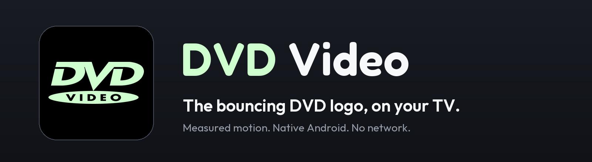
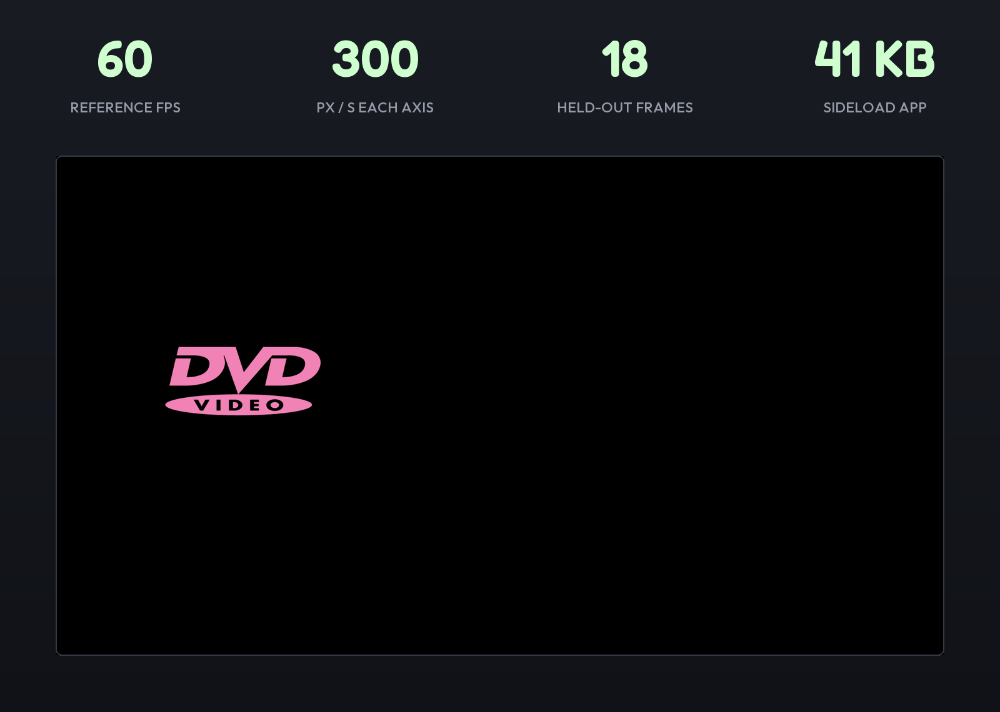

<p align="center">
  
</p>

<p align="center">
  <a href="https://github.com/TheWombRaider/dvd-tv/stargazers"></a>
  <a href="https://github.com/TheWombRaider/dvd-tv/commits/main"></a>
  <a href="LICENSE"></a>
  
  <a href="https://github.com/Gathin23/cleanyourtv"></a>
</p>

<p align="center">
  
</p>

**DVD Video screensaver for Android TV** brings the floating DVD logo to Android TV and Google TV: one logo, a black screen, and a new color at each wall contact. It follows the measured motion of [Raul Blanco's 4K, 60 fps recording](https://youtu.be/5mGuCdlCcNM), using the same fidelity-first approach as [3D Pipes](https://github.com/TheWombRaider/pipes-tv).

*Unofficial. DVD and DVD VIDEO names and logos belong to their respective owners. No affiliation or endorsement is claimed. No video or audio recording is bundled.*

## How it works

1. The white DVD VIDEO logo starts at the reference recording's opening position.
2. It moves diagonally in five-pixel steps, 60 times per second at 1080p. A missed display frame does not slow the simulation.
3. Just before a step would cross a wall, that axis turns around. The small gap at the wall is intentional: it is in the reference.
4. Color changes on the contact frame, one tick before travel visibly reverses. Both axes reverse at a simultaneous corner; there is no forced corner hit or celebration.

No internet permission, no ads, no analytics, no audio, no settings screen. Rendering stops when the preview or screensaver is hidden. A native DreamService and the launcher preview share the same renderer.

## Quick start

Use an Android TV / Google TV device on the same network as a computer with a JDK, the Android SDK and ADB. Accept the TV's debugging authorization when connecting.

| Step | Command |
|---|---|
| Build and check | `./gradlew testDebugUnitTest lintRelease assembleRelease` (Windows: `gradlew.bat`) |
| Connect | `adb connect <tv-ip>`; use the address/port shown by Wireless debugging where applicable |
| Install | `adb install -r app/build/outputs/apk/release/app-release.apk` |
| Preview | Open **DVD Video** from the TV launcher, or `adb shell am start -n io.github.thewombraider.dvdtv/.PreviewActivity` |
| Exit preview | Press Back or a D-pad direction/OK |

The sideload release is signed with the local Android debug key, following pipes-tv. Build it yourself; APKs and signing keys are not committed.

**Installing or opening the preview does not select a new screensaver.** To use it later, choose DVD Video in the TV's system screensaver settings. On firmware that hides that picker, first save the current values:

```sh
adb shell settings get secure screensaver_components
adb shell settings get secure screensaver_enabled
# Only when you choose to change your active screensaver:
adb shell settings put secure screensaver_components io.github.thewombraider.dvdtv/.DvdDreamService
adb shell settings put secure screensaver_enabled 1
```

Restore the saved values to undo that selection. TCL firmware can restrict automatic startup of sideloaded DreamServices; pipes-tv documents that vendor behavior. Automatic activation of this app was deliberately not tested by changing the user's selected screensaver. Its launcher preview is the tested device path; see [validation](docs/VALIDATION.md).

## What you get

- The actual reference logo silhouette, including the VIDEO lettering and oval, as a small tintable alpha mask extracted at 4K.
- The reference's 336-by-148-pixel footprint in its 1920-by-1080 coordinate plane, scaled uniformly to the screen.
- Measured preemptive wall reflections, small edge gaps and contact-frame color changes.
- The 78 measured opening color states, followed by deterministic pastel colors rather than a loop of the recording.
- A monotonic clock that pauses while hidden, a single pending animation callback, and no idle background loop.
- Aspect-preserving fitting on other screen shapes; non-16:9 screens receive black margins rather than a stretched logo.

<p align="center">
  
</p>

## How faithful it is

The first five seconds establish the movement rule. Eighteen later frames, through 146.08 seconds, are held out for checking. The production Java simulation matches those positions with **zero pixel error** and the sampled colors to **one RGB level**. This is a comparison against decoded video measurements, not a test of one copy of the formula against another.

Two details matter: continuous geometric reflection gives the wrong wall clearance, and changing color only on the first reversed step is one frame late. Independent footage checks caught both the timing distinction and a short-lived color state missed by coarse sampling.

Limits are explicit:

- The clipped final frame at 150 seconds differs by two ticks / 10 pixels. Its source is unresolved and it is retained as an excluded diagnostic, not counted as a pass.
- The original random seed and later ten-hour color sequence are unknown. After the measured opening states, this app generates its own deterministic pastels. It does not claim to reproduce all ten hours frame for frame.
- Exact corner-color ordering is not established by the measured sample. The app changes color once when both axes meet an edge together.
- Video compression and Android bitmap filtering affect edge pixels. Actual TV captures are checked separately; their results and tolerances are in [docs/VALIDATION.md](docs/VALIDATION.md).

Measurements, provenance and implementation choices: [reference analysis](docs/REFERENCE_ANALYSIS.md), [measured frames](docs/reference/measurements.json), [palette](docs/reference/palette.json), [source hashes](docs/reference/provenance.json).

## For developers

Set `JAVA_HOME` to the JDK and `ANDROID_HOME` to the Android SDK. The build uses Gradle 8.9, Android Gradle Plugin 8.5.2 and SDK 34, matching the existing pipes-tv toolchain. `local.properties` is local and ignored.

```sh
./gradlew testDebugUnitTest lintRelease assembleRelease
python tools/check_reference.py
```

The JVM tests cover discrete reflections, simultaneous corners, extreme elapsed times, color progression, held-out frames, pause/resume, callback cancellation, 30/60/120 Hz equivalence, viewport fitting and malformed preview extras. Test output, APK size, device checks and unverified items are recorded in [validation](docs/VALIDATION.md).

For reproducible screenshots, the preview alone accepts bounded `capture_tick` (long), `capture_time_ms` (long) and `capture_freeze` (boolean) extras:

```sh
adb shell am start -S -n io.github.thewombraider.dvdtv/.PreviewActivity --el capture_tick 600 --ez capture_freeze true
```

The production DreamService never reads those extras. `tools/verify_tv_preview.py --serial <adb-device>` checks actual preview captures and preserves screensaver settings. Use `--wake-and-restore` only when temporarily waking a sleeping TV is authorized. Local evidence stays under ignored `work/`. These two analysis tools require Python with OpenCV and NumPy; `tools/make_readme_art.py` also uses Pillow and Google Fonts' Fredoka/Outfit files to regenerate the static README artwork.

[PROJECT_PROMPT.md](PROJECT_PROMPT.md) is the build brief, refined with the [be-ambitious assessment](docs/BE_AMBITIOUS.md). Shared progress and recovery notes are in docs/AI_STATE.md, docs/AI_DECISIONS.md and docs/AI_HANDOFF.md. The initial implementation ran through OpenCode and OmniRoute using the official Codex client; provider switching is manual, with official Antigravity available if quota interrupts a task. No custom model router was built.

## Credits and license

Application source: MIT, see [LICENSE](LICENSE). DVD branding, the user-supplied reference, fonts and README styling have separate credits in [NOTICE](NOTICE). The presentation follows [pipes-tv](https://github.com/TheWombRaider/pipes-tv), itself inspired by [cleanyourtv](https://github.com/Gathin23/cleanyourtv).
